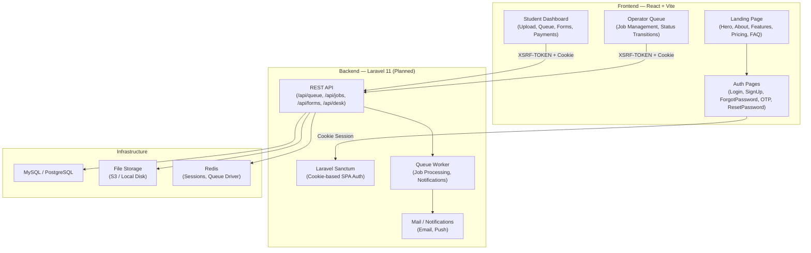
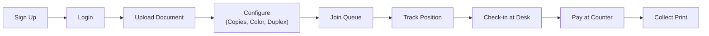
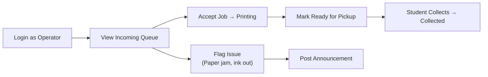
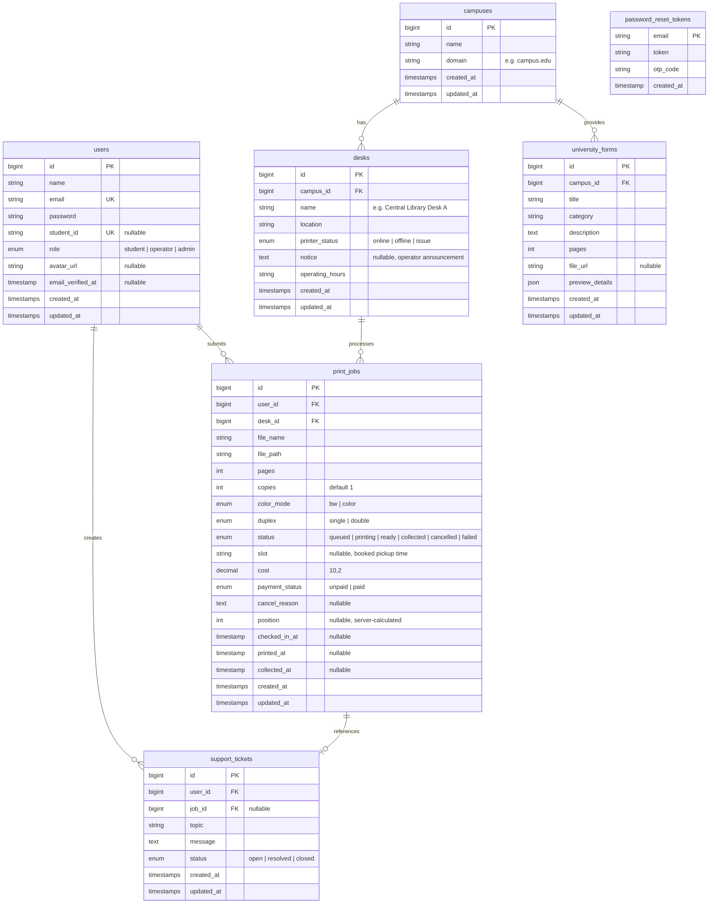
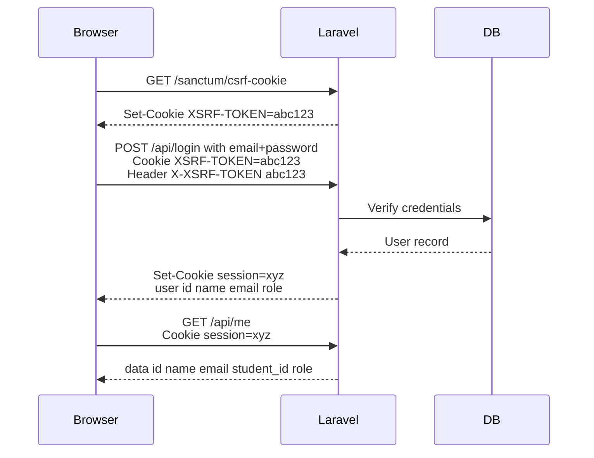

# Print-Fy — System Design Document

> **Status:** Pilot / Pre-Launch (DEMO_MODE = true)
> **Last Updated:** October 23, 2026
> **Author:** Faiqa Arooj

---

## Table of Contents

1. [Project Overview](#1-project-overview)
2. [Architecture Diagram](#2-architecture-diagram)
3. [Current State Audit](#3-current-state-audit)
4. [User Roles & Flows](#4-user-roles--flows)
5. [Frontend — What You Need](#5-frontend--what-you-need)
6. [Backend — What You Need](#6-backend--what-you-need)
7. [Credentials & API Keys Checklist](#7-credentials--api-keys-checklist)
8. [Cost Breakdown — What You'll Pay](#8-cost-breakdown--what-youll-pay)
9. [Database Schema](#9-database-schema)
10. [API Contract](#10-api-contract)
11. [Deployment & DevOps](#11-deployment--devops)
12. [Security Considerations](#12-security-considerations)
13. [Phase Roadmap](#13-phase-roadmap)

---

## 1. Project Overview

**Print-Fy** is a campus print-queue management system that lets students upload documents, join a digital queue, track their print job status in real-time, and collect their printout when it's ready — eliminating the need to physically wait at the print shop.

### Core Value Proposition

| Problem | Print-Fy Solution |
|---|---|
| Students physically wait in line | Digital FIFO queue with real-time position tracking |
| No visibility into printer status | Live status: Queued → Printing → Ready → Collected |
| Paper/ink issues surprise everyone | Operator can flag blocking issues, students get notified |
| No arrival coordination | Time-slot booking with desk check-in system |

### Three User Types

| Role | What They Do |
|---|---|
| **Student** | Upload documents, join queue, track status, check-in at desk, collect prints |
| **Operator** | View incoming jobs, advance statuses, flag issues, manage queue |
| **Admin** *(future)* | Configure desks, manage operators, view analytics |

---

## 2. Architecture Diagram



---

## 3. Current State Audit

> [!IMPORTANT]
> The frontend is substantially built. The backend does not exist yet. Everything currently runs in `DEMO_MODE = true` with mock data.

### ✅ What's Built (Frontend)

| Component | File | Status |
|---|---|---|
| Landing Page (Hero, About, Features, Pricing, CTA, Footer) | [App.jsx](file:///Users/apple/Desktop/Print-fy%20development%20scracth/src/App.jsx) | ✅ Complete |
| Hash-based Routing | [App.jsx](file:///Users/apple/Desktop/Print-fy%20development%20scracth/src/App.jsx#L21-L196) | ✅ Working |
| Login Page | [Login.jsx](file:///Users/apple/Desktop/Print-fy%20development%20scracth/src/pages/auth/Login.jsx) | ✅ UI complete, API mocked |
| SignUp Page | [SignUp.jsx](file:///Users/apple/Desktop/Print-fy%20development%20scracth/src/pages/auth/SignUp.jsx) | ✅ UI complete, API mocked |
| Forgot Password → OTP → Reset flow | [ForgotPassword.jsx](file:///Users/apple/Desktop/Print-fy%20development%20scracth/src/pages/auth/ForgotPassword.jsx), [VerifyOtp.jsx](file:///Users/apple/Desktop/Print-fy%20development%20scracth/src/pages/auth/VerifyOtp.jsx), [ResetPassword.jsx](file:///Users/apple/Desktop/Print-fy%20development%20scracth/src/pages/auth/ResetPassword.jsx) | ✅ UI complete, API mocked |
| Student Dashboard (Overview, Upload, Queue, Forms, Payment) | [StudentDashboard.jsx](file:///Users/apple/Desktop/Print-fy%20development%20scracth/src/pages/dashboard/StudentDashboard.jsx), [Views](file:///Users/apple/Desktop/Print-fy%20development%20scracth/src/components/dashboard/views/) | ✅ Fully interactive demo |
| Operator Queue (Job management, Status transitions, Document preview) | [OperatorQueue.jsx](file:///Users/apple/Desktop/Print-fy%20development%20scracth/src/pages/operator/OperatorQueue.jsx), [jobTransitions.js](file:///Users/apple/Desktop/Print-fy%20development%20scracth/src/pages/operator/jobTransitions.js) | ✅ Fully interactive demo |
| API Client (Sanctum-ready, XSRF handling) | [api.ts](file:///Users/apple/Desktop/Print-fy%20development%20scracth/src/lib/api.ts) | ✅ Ready to connect |
| Queue ordering logic | [queueOrder.ts](file:///Users/apple/Desktop/Print-fy%20development%20scracth/src/lib/queueOrder.ts) | ✅ Pure functions |
| Time formatting (Asia/Karachi timezone) | [time.ts](file:///Users/apple/Desktop/Print-fy%20development%20scracth/src/lib/time.ts) | ✅ Complete |
| Mock Data (Queue, Forms, Operator Jobs) | [mocks/](file:///Users/apple/Desktop/Print-fy%20development%20scracth/src/mocks/) | ✅ Demo-grade |
| Contact/Support Page | [ContactPage.jsx](file:///Users/apple/Desktop/Print-fy%20development%20scracth/src/components/ContactPage.jsx) | ✅ UI complete, submission mocked |

### ❌ What's NOT Built Yet

| Component | Notes |
|---|---|
| **Laravel Backend** | No server, no API endpoints, no database |
| **File Upload Pipeline** | Frontend form exists but no actual upload-to-storage |
| **Real Authentication** | Sanctum endpoints don't exist; login falls back to mock |
| **Payment Processing** | UI exists (checkout view), but no payment gateway integrated |
| **Push Notifications** | Only in-page notification previews; no FCM / real push |
| **Email Notifications** | No OTP emails, no "your print is ready" emails |
| **Admin Panel** | Not started at all |
| **Google OAuth** | Login page shows Google button but it's a placeholder |

---

## 4. User Roles & Flows

### Student Journey



### Operator Journey



---

## 5. Frontend — What You Need

### Current Stack

| Technology | Version | Purpose |
|---|---|---|
| React | 19.2.7 | UI library |
| Vite | 8.1.0 | Build tool & dev server |
| Framer Motion | 14.0.0 | Animations |
| Vanilla CSS | — | Styling (no Tailwind) |

### What You Still Need to Install

| Package | Purpose | Install Command | Cost |
|---|---|---|---|
| `react-router-dom` | Proper routing (replace hash-based) | `npm i react-router-dom` | **Free** |
| `axios` *(optional)* | Better HTTP client with interceptors | `npm i axios` | **Free** |
| `react-hot-toast` or `sonner` | Toast notifications | `npm i sonner` | **Free** |
| `react-dropzone` | Drag-and-drop file upload | `npm i react-dropzone` | **Free** |
| `firebase` *(if using FCM)* | Push notifications client | `npm i firebase` | **Free SDK** |

> [!NOTE]
> The current hash-based routing in [App.jsx](file:///Users/apple/Desktop/Print-fy%20development%20scracth/src/App.jsx) works for demo but **will not scale**. Migrating to `react-router-dom` is strongly recommended before launch.

### Frontend Effort Estimate

| Task | Effort | Priority |
|---|---|---|
| Replace hash routing with `react-router-dom` | 2–3 days | 🔴 High |
| Connect all `DEMO_MODE` paths to real API | 3–4 days | 🔴 High |
| Add file upload with progress bar | 1–2 days | 🔴 High |
| Integrate push notifications (FCM) | 1–2 days | 🟡 Medium |
| Add loading skeletons & error boundaries | 1–2 days | 🟡 Medium |
| Google OAuth button → real flow | 1 day | 🟡 Medium |
| Payment gateway UI (Stripe/JazzCash widget) | 2–3 days | 🟢 Post-pilot |
| Responsive polish (375–1920px breakpoints) | 2–3 days | 🟡 Medium |
| **Total Frontend Remaining** | **~15–20 days** | — |

---

## 6. Backend — What You Need

### Recommended Stack

| Technology | Purpose | Why |
|---|---|---|
| **Laravel 11** | API framework | Your [api.ts](file:///Users/apple/Desktop/Print-fy%20development%20scracth/src/lib/api.ts) already uses Sanctum conventions |
| **Laravel Sanctum** | SPA cookie authentication | Already coded into the frontend XSRF flow |
| **MySQL 8** or **PostgreSQL 16** | Primary database | Standard for Laravel |
| **Redis** | Session store + Queue driver | Fast sessions, reliable job processing |
| **Laravel Queues** | Background jobs (notifications, cleanup) | Decouple heavy work from requests |
| **S3-compatible storage** | Document file storage | DigitalOcean Spaces / AWS S3 / Cloudflare R2 |

### API Endpoints to Build

These are directly referenced in your [api.ts](file:///Users/apple/Desktop/Print-fy%20development%20scracth/src/lib/api.ts):

#### Auth & Sanctum

| Method | Endpoint | Request | Response |
|---|---|---|---|
| `GET` | `/sanctum/csrf-cookie` | — | Sets `XSRF-TOKEN` cookie |
| `POST` | `/api/login` | `{ email, password }` | `{ user: { id, name, email, role } }` |
| `POST` | `/api/logout` | — | `204 No Content` |
| `GET` | `/api/me` | — | `{ data: { id, name, email, student_id, role } }` |
| `POST` | `/api/me/password` | `{ current_password, password, password_confirmation }` | `{ message }` |
| `POST` | `/api/forgot-password` | `{ email }` | `{ message }` + sends OTP email |
| `POST` | `/api/verify-otp` | `{ email, code }` | `{ reset_token }` |
| `POST` | `/api/reset-password` | `{ reset_token, password, password_confirmation }` | `{ message }` |
| `POST` | `/api/register` | `{ name, email, password }` | `{ user }` |

#### Queue & Jobs

| Method | Endpoint | Request | Response | Privacy Note |
|---|---|---|---|---|
| `GET` | `/api/queue` | — | `{ data: QueueJob[] }` | ⚠️ Never expose other students' names/IDs/files |
| `POST` | `/api/jobs/{id}/slot` | `{ slot }` | `{ data: { job, queue } }` | Server recalculates positions |
| `POST` | `/api/jobs/{id}/check-in` | — | `{ data: { success, job, queue } }` | Server validates arrival window |
| `POST` | `/api/jobs/{id}/cancel` | — | `{ data: { success, message, queue } }` | |

#### Desk & Forms

| Method | Endpoint | Response |
|---|---|---|
| `GET` | `/api/desk` | `{ data: { printerStatus, notice, location, queueTrafficCount } }` |
| `GET` | `/api/forms` | `{ data: UniversityForm[] }` |
| `POST` | `/api/forms/{id}/print-job` | `{ data: { jobId } }` |

#### Support

| Method | Endpoint | Request |
|---|---|---|
| `GET` | `/api/my-jobs?limit=10` | — |
| `POST` | `/api/support-tickets` | `{ topic, job_id?, message }` |
| `DELETE` | `/api/saved-documents` | — |

#### Operator Endpoints *(new, not yet in api.ts)*

| Method | Endpoint | Purpose |
|---|---|---|
| `GET` | `/api/operator/queue` | Full queue with student details (operator-only) |
| `POST` | `/api/operator/jobs/{id}/status` | Advance job status (printing → ready → collected) |
| `POST` | `/api/operator/jobs/{id}/issue` | Flag a blocking issue |
| `POST` | `/api/operator/announcements` | Post desk-wide announcement |

### Backend Effort Estimate

| Task | Effort | Priority |
|---|---|---|
| Laravel project setup + Sanctum auth | 2–3 days | 🔴 High |
| Database migrations & models | 2–3 days | 🔴 High |
| Auth endpoints (login, register, forgot-password, OTP, reset) | 3–4 days | 🔴 High |
| Queue endpoints (CRUD, slot change, check-in) | 3–4 days | 🔴 High |
| File upload endpoint + S3 integration | 2–3 days | 🔴 High |
| Operator endpoints (status transitions, issues) | 2–3 days | 🔴 High |
| Desk & Forms endpoints | 1–2 days | 🟡 Medium |
| Email notifications (OTP, job ready, issue alerts) | 2–3 days | 🟡 Medium |
| Support ticket system | 1–2 days | 🟡 Medium |
| Push notifications (FCM backend integration) | 2–3 days | 🟢 Post-pilot |
| Payment gateway integration | 3–5 days | 🟢 Post-pilot |
| **Total Backend** | **~25–35 days** | — |

---

## 7. Credentials & API Keys Checklist

> [!CAUTION]
> **Never commit API keys to Git.** Use `.env` files locally and environment variables in production.

### 🔴 Required Before Pilot Launch

| Credential | Where to Get It | What It's For | Cost |
|---|---|---|---|
| **Domain Name** | [Namecheap](https://namecheap.com) / [Google Domains](https://domains.google) | `printfy.app` or similar | ~$10–15/year |
| **SSL Certificate** | Auto via hosting provider (Let's Encrypt) | HTTPS encryption | **Free** |
| **SMTP Email Service** | [Mailtrap](https://mailtrap.io) (dev) → [Mailgun](https://mailgun.com) / [Resend](https://resend.com) (prod) | OTP emails, notifications | Free tier → ~$15/mo |
| **DB_HOST, DB_DATABASE, DB_USERNAME, DB_PASSWORD** | Your hosting provider (PlanetScale / Railway / DigitalOcean) | MySQL connection | Included in hosting |
| **APP_KEY** | `php artisan key:generate` | Laravel encryption key | **Free** (auto-generated) |
| **SANCTUM_STATEFUL_DOMAINS** | Your `.env` | List your frontend domain for cookie auth | **Free** (config) |
| **SESSION_DOMAIN** | Your `.env` | Cookie domain scope | **Free** (config) |

### 🟡 Required for Full Functionality

| Credential | Where to Get It | What It's For | Cost |
|---|---|---|---|
| **AWS / S3 / R2 Keys** (`AWS_ACCESS_KEY_ID`, `AWS_SECRET_ACCESS_KEY`, `AWS_BUCKET`) | [AWS Console](https://aws.amazon.com/s3/) / [Cloudflare R2](https://dash.cloudflare.com) / [DO Spaces](https://cloud.digitalocean.com/spaces) | Document file storage | Free tier → ~$5/mo |
| **REDIS_HOST, REDIS_PASSWORD** | [Upstash](https://upstash.com) / [Redis Cloud](https://redis.com/cloud) / Your VPS | Sessions + Queue driver | Free tier → ~$5/mo |
| **MAIL_HOST, MAIL_USERNAME, MAIL_PASSWORD** | SMTP provider | Transactional emails | ~$0–15/mo |
| **Google OAuth** (`GOOGLE_CLIENT_ID`, `GOOGLE_CLIENT_SECRET`) | [Google Cloud Console](https://console.cloud.google.com/apis/credentials) | "Sign in with Google" | **Free** |

### 🟢 Future / Post-Pilot

| Credential | Where to Get It | What It's For | Cost |
|---|---|---|---|
| **FCM Server Key** (`FIREBASE_CREDENTIALS`) | [Firebase Console](https://console.firebase.google.com) | Push notifications | **Free** (up to limits) |
| **Stripe Keys** (`STRIPE_KEY`, `STRIPE_SECRET`) or **JazzCash** | [Stripe Dashboard](https://dashboard.stripe.com/apikeys) / [JazzCash Merchant](https://www.jazzcash.com.pk) | Online payments | 2.9% + 30¢ per txn |
| **Sentry DSN** | [Sentry.io](https://sentry.io) | Error tracking (frontend + backend) | Free tier → ~$26/mo |
| **Analytics** (`GA_MEASUREMENT_ID`) | [Google Analytics](https://analytics.google.com) | Usage analytics | **Free** |

### Your `.env` File Template

```env
# ─── Application ───
APP_NAME=PrintFy
APP_ENV=production
APP_KEY=base64:GENERATE_THIS
APP_DEBUG=false
APP_URL=https://printfy.app

# ─── Database ───
DB_CONNECTION=mysql
DB_HOST=127.0.0.1
DB_PORT=3306
DB_DATABASE=printfy
DB_USERNAME=printfy_user
DB_PASSWORD=CHANGE_ME

# ─── Redis ───
REDIS_HOST=127.0.0.1
REDIS_PASSWORD=null
REDIS_PORT=6379

# ─── Sanctum (SPA Auth) ───
SANCTUM_STATEFUL_DOMAINS=printfy.app,localhost:5173
SESSION_DOMAIN=.printfy.app
SESSION_DRIVER=redis

# ─── Mail ───
MAIL_MAILER=smtp
MAIL_HOST=smtp.mailgun.org
MAIL_PORT=587
MAIL_USERNAME=CHANGE_ME
MAIL_PASSWORD=CHANGE_ME
MAIL_FROM_ADDRESS=noreply@printfy.app
MAIL_FROM_NAME="Print-Fy"

# ─── File Storage ───
FILESYSTEM_DISK=s3
AWS_ACCESS_KEY_ID=CHANGE_ME
AWS_SECRET_ACCESS_KEY=CHANGE_ME
AWS_DEFAULT_REGION=ap-south-1
AWS_BUCKET=printfy-documents
AWS_URL=https://printfy-documents.s3.amazonaws.com

# ─── Google OAuth (optional) ───
GOOGLE_CLIENT_ID=CHANGE_ME
GOOGLE_CLIENT_SECRET=CHANGE_ME
GOOGLE_REDIRECT_URI=https://printfy.app/auth/google/callback

# ─── Firebase Push (future) ───
# FIREBASE_CREDENTIALS=/path/to/firebase-service-account.json

# ─── Payments (future) ───
# STRIPE_KEY=pk_live_CHANGE_ME
# STRIPE_SECRET=sk_live_CHANGE_ME

# ─── Error Tracking (recommended) ───
# SENTRY_LARAVEL_DSN=https://xxx@sentry.io/yyy
```

---

## 8. Cost Breakdown — What You'll Pay

### Pilot Stage (1 campus, <500 students)

| Service | Provider Option | Monthly Cost |
|---|---|---|
| **Hosting (Backend)** | [Railway](https://railway.app) / [Render](https://render.com) / DigitalOcean $6 Droplet | **$0–12** |
| **Hosting (Frontend)** | [Vercel](https://vercel.com) / [Netlify](https://netlify.com) / [Cloudflare Pages](https://pages.cloudflare.com) | **$0** (free tier) |
| **Database** | Railway Postgres / PlanetScale free tier / DO Managed DB | **$0–15** |
| **Redis** | Upstash free tier / Railway Redis | **$0–5** |
| **File Storage** | Cloudflare R2 (10 GB free) / AWS S3 Free Tier | **$0–5** |
| **Email** | Resend (3,000 emails/mo free) / Mailgun (5,000 free) | **$0** |
| **Domain** | `.app` or `.com` | **~$1/mo** (~$12/yr) |
| **SSL** | Let's Encrypt (auto via host) | **$0** |
| **Error Tracking** | Sentry free tier (5K events/mo) | **$0** |
| | | |
| **TOTAL PILOT** | | **$1–37/month** |

### Growth Stage (5 campuses, ~2,000 students)

| Service | Provider Option | Monthly Cost |
|---|---|---|
| **Hosting (Backend)** | DigitalOcean $24 Droplet / Railway Pro | **$12–24** |
| **Hosting (Frontend)** | Vercel Pro / Cloudflare Pages | **$0–20** |
| **Database** | Managed MySQL/Postgres | **$15–30** |
| **Redis** | Upstash Pro / Managed Redis | **$5–10** |
| **File Storage** | S3 / R2 (~50 GB) | **$5–15** |
| **Email** | Mailgun / Resend paid tier | **$15–35** |
| **Push Notifications** | Firebase FCM | **$0** |
| **Payments** | Stripe (per-transaction, no monthly) | **2.9%+30¢/txn** |
| | | |
| **TOTAL GROWTH** | | **$52–134/month** + txn fees |

> [!TIP]
> **Cheapest viable pilot stack:** Vercel (frontend, free) + Railway (backend + DB + Redis, ~$5–10) + Cloudflare R2 (storage, free) + Resend (email, free) = **under $15/month**.

---

## 9. Database Schema



---

## 10. API Contract

### Authentication Flow



### Queue Privacy Model

> [!WARNING]
> **Critical privacy rule from your codebase:** The Laravel API must **NEVER** send other students' personal names, student IDs, avatar images, or file names in the queue response. Only expose: `position`, `slot`, `status`, and `genericAlias` (e.g., "Student A").
>
> The operator endpoint (`/api/operator/queue`) is the **only** endpoint that returns full student details, and it requires `role: operator` middleware.

---

## 11. Deployment & DevOps

### Recommended Setup

```
printfy.app              → Vercel / Cloudflare Pages (React SPA)
api.printfy.app           → Railway / DigitalOcean (Laravel API)
*.printfy-documents.r2    → Cloudflare R2 (File Storage)
```

### Environment Separation

| Environment | Frontend | Backend | Database |
|---|---|---|---|
| **Local Dev** | `localhost:5173` | `localhost:8000` | SQLite / Docker MySQL |
| **Staging** | `staging.printfy.app` | `api-staging.printfy.app` | Separate DB instance |
| **Production** | `printfy.app` | `api.printfy.app` | Production DB (backups!) |

### CI/CD Pipeline (GitHub Actions)

```yaml
# Simplified — you'll need:
# 1. Lint + Type-check on every PR
# 2. Run Laravel tests (PHPUnit) on every PR
# 3. Auto-deploy frontend to Vercel on merge to main
# 4. Auto-deploy backend to Railway on merge to main
```

---

## 12. Security Considerations

| Area | Implementation | Status |
|---|---|---|
| **Authentication** | Laravel Sanctum (cookie-based, no tokens in localStorage) | ✅ Frontend ready |
| **CSRF Protection** | XSRF-TOKEN cookie + X-XSRF-TOKEN header | ✅ Frontend ready |
| **Password Hashing** | bcrypt (Laravel default) | 🔲 Backend needed |
| **File Upload Validation** | Server-side MIME check, max size, PDF/image only | 🔲 Backend needed |
| **Rate Limiting** | Laravel throttle middleware on auth + support endpoints | 🔲 Backend needed |
| **Queue Privacy** | Server strips PII from queue response for students | 🔲 Backend needed |
| **SQL Injection** | Eloquent ORM parameterized queries | 🔲 Backend needed |
| **XSS** | React auto-escapes; no `dangerouslySetInnerHTML` used | ✅ Safe |
| **CORS** | Sanctum handles stateful domains | 🔲 Backend needed |
| **File Deletion** | Retention policy TBD; delete after X days or on student request | 🔲 Not decided |

---

## 13. Phase Roadmap

### Phase 1 — Pilot MVP (Target: 4–6 weeks)

| # | Task | Owner | Duration |
|---|---|---|---|
| 1 | Laravel project setup + Sanctum + DB migrations | Backend | 1 week |
| 2 | Auth endpoints (register, login, forgot-password, OTP, reset) | Backend | 1 week |
| 3 | File upload endpoint + S3 storage | Backend | 3 days |
| 4 | Queue endpoints (submit, track, slot change, check-in, cancel) | Backend | 1 week |
| 5 | Operator endpoints (view queue, advance status, flag issues) | Backend | 1 week |
| 6 | Connect frontend `DEMO_MODE` → real API | Frontend | 1 week |
| 7 | Replace hash routing with `react-router-dom` | Frontend | 2 days |
| 8 | Email notifications (OTP, job ready, issue alerts) | Backend | 3 days |
| 9 | Testing + responsive polish + deploy | Both | 1 week |

### Phase 2 — Post-Pilot Enhancements

- Student job history and document reuse
- Document preview in dashboard
- Operator analytics and daily reports
- Push notifications (Firebase Cloud Messaging)
- Google OAuth login

### Phase 3 — Expansion

- Multi-campus / multi-desk support
- Online payment integration (Stripe / JazzCash)
- Automatic desk rerouting when capacity is full
- Admin panel for university IT staff
- iOS companion app

---

## Summary

| Metric | Value |
|---|---|
| **Frontend completion** | ~75–80% (UI done, needs API wiring + routing) |
| **Backend completion** | 0% (not started) |
| **Credentials needed for pilot** | 6–8 (domain, DB, SMTP, S3, Sanctum config, APP_KEY) |
| **Monthly cost for pilot** | **$1–37** |
| **Total effort to pilot launch** | **~6–8 weeks** (1 full-stack developer) |
| **Total effort to pilot launch** | **~4–5 weeks** (separate frontend + backend devs) |

> [!TIP]
> Your frontend is in great shape — the API client in [api.ts](file:///Users/apple/Desktop/Print-fy%20development%20scracth/src/lib/api.ts) already speaks Sanctum and every endpoint is documented with TODO comments. The fastest path to launch is standing up the Laravel backend and flipping `DEMO_MODE` to `false` in [config.ts](file:///Users/apple/Desktop/Print-fy%20development%20scracth/src/lib/config.ts#L18).
